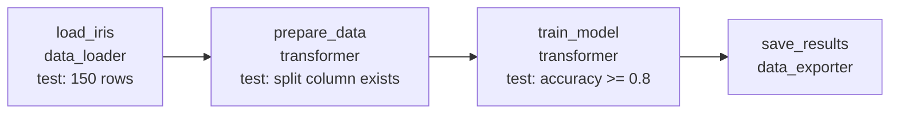
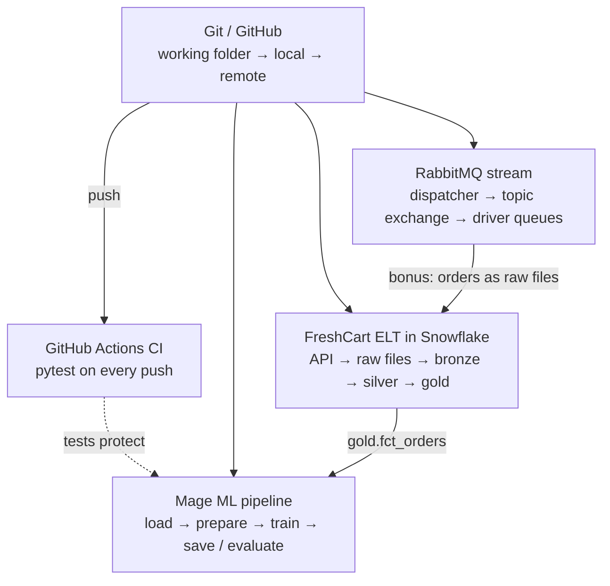

# Assignment: From Git to Gold: Report

**Name:** ________  **Roll No:** ________  
**GitHub repository:** https://github.com/Shristirajpoot/freshcart-pipelines

> Fill the `[...]` placeholders with your own run outputs/screenshots (appendix). Read every answer so you can explain it in the viva.

---

## Part A: Git and CI/CD

### A1. Repository and commit history
Structure: `README.md, .gitignore, requirements.txt, elt/, iris_project/, stream/, tests/test_prepare_data.py, .github/workflows/ci.yml`.

```
[paste the output of: git log --oneline]
```

### A2. Where does each command act?

| Command | Where the change happens | What exactly happens? |
|---|---|---|
| `git init` | Working folder (creates the local repository) | Creates a hidden `.git` folder, so the folder can now track history. |
| `git add train.py` | Working folder → staging area | Marks the current version of `train.py` to be included in the next commit. |
| `git commit -m "msg"` | Staging area → local repository | Saves a snapshot of everything staged, with a message, into the local history. |
| `git remote add origin URL` | Local repository settings | Stores a short name (`origin`) pointing to the GitHub URL; nothing is sent yet. |
| `git push -u origin main` | Local repository → remote Git | Uploads the local commits on `main` to GitHub and remembers `origin/main` as the default upstream. |
| `git pull origin main` | Remote Git → local repository and working folder | Downloads new commits from GitHub and merges them into my branch and files. |

**After `git commit`, can your teammate see your code on GitHub?** No. A commit only saves to my *local* repository. The teammate sees it only after `git push` sends it to the remote.

### A3. CI workflow
`.github/workflows/ci.yml` runs on every push: checkout → Python 3.12 → `pip install -r requirements.txt` → `pytest`.
- Green run screenshot: `[appendix A3-green]`
- Red run (`test_size = 0.3` → 135/45 split, the assertion `== 120` fails): `[appendix A3-red]`
- Fix commit and green again: `[appendix A3-fixed]`

---

## Part B: FreshCart ELT

### B1. Baseline (screenshots in appendix)

| Check | Expected | Mine |
|---|---|---|
| Raw order rows in bronze after one run | 8 (6 web + 2 mobile) | [ ] |
| Rows passing cleaning | 6 | [ ] |
| Rows in quarantine | 2 (ORD-1004, ORD-1006) | [ ] |
| Orders after dedup | 4 | [ ] |
| Final gold line | 4 orders, revenue 7,785.00, 126 points | [ ] |
| Share rejected | 25% | [ ] |

### B2. Trace ORD-1003
1. **Raw records.** The web copy is flat: `order_id, cust_email, cust_name, order_date, amount (null), currency, pincode, updated_at`. The mobile copy is nested and uses other names: `orderId, customer.email, customer.name, orderDate, total.value, total.currency, deliveryPin, updatedAt`. They differ because the two APIs were built independently; bronze stores each exactly as received.
2. **Unifying SQL.** In the `unified` CTE of `SQL_10_ORDERS_CLEAN`, web uses `raw:order_id`, `raw:cust_email`, `raw:amount` … and mobile uses `raw:orderId`, `raw:customer.email`, `raw:total.value`, `raw:deliveryPin` … mapped to the same column names. The `typed` CTE then cleans them: `LOWER(TRIM(...))`, `TRY_TO_DECIMAL(REGEXP_REPLACE(...))`, `COALESCE(TRY_TO_DATE(... 'DD/MM/YYYY'))` etc.
3. **Which copy survives.** In `SQL_20_ORDERS_DEDUP`: `QUALIFY ROW_NUMBER() OVER (PARTITION BY order_id ORDER BY updated_at DESC, ingest_seq DESC) = 1`. The mobile copy has the later `updated_at` (2026-09-02 18:40 vs 09:10), so it is row number 1 and survives; it is also the one with the amount.
4. **Gold calculation.** amount 2,100.00 INR × fx 1.0 = `amount_inr` 2,100.00. Meera is Platinum (multiplier 3). `loyalty_points = FLOOR(2100 / 100) × 3 = 21 × 3 = 63`.

**ORD-1005 (Gold) vs ORD-1001 (Silver) for Priya.** Priya changed tier from Silver to Gold on 2026-09-03 (SCD2 table `dim.customers_scd2`). The join in `SQL_40_GOLD` is `c.email = o.email AND o.order_date BETWEEN c.valid_from AND c.valid_to`, which picks the tier valid *on the order date*. ORD-1001 (09-01) falls in the Silver period (multiplier 1), ORD-1005 (09-03) in the Gold period (multiplier 2).

### B3. New validation rule
Added inside `ARRAY_CONSTRUCT_COMPACT(...)`:
```sql
IFF(COALESCE(currency, '') NOT IN ('INR', 'USD'), 'unsupported_currency', NULL)
```
- ORD-1006 `reasons` before: `["bad_email","bad_pincode"]`; after: `["bad_email","bad_pincode","unsupported_currency"]`. `[screenshot]`
- **Does the gold total change?** No. ORD-1006 was already rejected, so it never reached gold, and all other orders are INR or USD.
- **A second quarantine row?** No. The `INSERT ... WHERE NOT EXISTS (SELECT 1 FROM quarantine.orders q WHERE q.source = c.source AND q.order_id = c.order_id AND q.row_data:UPDATED_AT = c.updated_at)` in `SQL_10` skips records already quarantined (same source, order and version).

### B4. SCD2 change and idempotency
Event added: `{"cust_id": "CUST-02", "email": "arjun.k@yahoo.in", "tier": "Gold", "effective_from": "2026-08-15"}`.

Predictions (written **before** running):

| Quantity | Prediction | Actual after run |
|---|---|---|
| Rows for CUST-02 in `dim.customers_scd2` | 2 (Silver 2024-01-15→2026-08-14, Gold 2026-08-15→9999-12-31) | [ ] |
| Tier used for ORD-1002 | Gold (order date 2026-09-01 is after 2026-08-15) | [ ] |
| Loyalty points for ORD-1002 | 70 (42.50 USD × 83.20 = 3,536.00 INR; FLOOR(35.36) = 35 × multiplier 2) | [ ] |
| Total loyalty points in gold | 161 (126 − 35 + 70) | [ ] |
| Gold rows whose `published_at` changed | 1 (only ORD-1002) | [ ] |

**Why gold is safe to re-run (4–6 sentences).** Every gold row carries a `row_hash` computed from all its business columns. The `MERGE` matches on `order_id`; for existing orders it only does an `UPDATE` when `t.row_hash <> s.row_hash`, so identical data is left untouched and `published_at` does not move. New order IDs are inserted, and no order is ever inserted twice because the key is `order_id`. Re-running therefore only changes rows whose values really changed (like ORD-1002 after the tier change) and the result of running twice equals running once. Bronze still grows by 8 rows on every run because it is an append-only copy of whatever was extracted (raw history), with duplicates removed later in silver by `ROW_NUMBER()`.

### B5. Sixth quality check
Check: *gold orders with `amount_inr` NULL but `amount` not NULL* (must be 0).
- Failing mock order: ORD-9001, USD 10.00 dated 2026-08-20, before the first FX rate (2026-09-01), so no rate and `amount_inr` is NULL. PROBLEM output: `[screenshot]`
- Mock order removed (also deleted from bronze, gold and quarantine because those tables keep rows), all checks OK again: `[screenshot]`

**Why ELT instead of ETL for FreshCart (3–4 sentences).** With ELT we load the raw API responses into Snowflake first and do the cleaning in SQL inside the warehouse, so the raw data stays in bronze unchanged. When a rule changes (like the new currency rule or the SCD2 fix) we just re-run SQL on the stored raw data, with no new extraction from the APIs, and Snowflake's compute scales for the heavy transforms. ETL would transform before loading, so the raw data would be lost and any rule change would need re-extraction. **ETL would still win** when sensitive data must be masked/removed *before* it reaches the warehouse (privacy/compliance), or when the target system is too small or weak to do the transformation itself.

---

## Part C: ML pipeline with Mage

### C1. Block graph

`mage run iris_project iris_classifier --test` output: `[appendix C1]`

### C2. Tests as a gate

| max_depth | Test accuracy | test_accuracy passed? | iris_predictions.csv created? |
|---|---|---|---|
| 1 | [ ] | [ ] | [ ] |
| 2 | [ ] | [ ] | [ ] |
| 3 | [ ] | [ ] | [ ] |
| 4 | [ ] | [ ] | [ ] |
| 5 | [ ] | [ ] | [ ] |

(the notebook cell fills this table for you)

**How a failing `@test` stops `save_results`.** Mage runs each block's `@test` function straight after the block. If an `assert` fails the block is marked as failed, so Mage does not run the blocks downstream of it. Here a failing `test_accuracy` in `train_model` means `save_results` is never started and no CSV is written. This is better than saving and checking afterwards because bad results never reach disk where someone might use them, and nothing has to be cleaned up.

### C3. Evaluation branch
`metadata.yaml` (final version): see `iris_project/pipelines/iris_classifier/metadata.yaml`. `train_model` has downstream blocks `[save_results, evaluate_model]`.
Confusion matrix and metrics table: `[appendix C3]`. Mage UI graph screenshot showing the branch: `[appendix C3-ui]`

### C4. My own block
`check_data` (transformer after `load_iris`) with `@test`: no missing values and exactly 3 classes. Output: `[appendix C4]`. CI still green after commit: `[appendix C4-ci]`

---

## Part D: RabbitMQ stream

### D1. Routing on paper

| # | Routing key | Receiving queues |
|---|---|---|
| 1 | bangalore.koramangala.food | Ravi, Meena, Control |
| 2 | bangalore.indiranagar.ride | Priya, Arjun, Control |
| 3 | bangalore.whitefield.ride | Arjun, Control |
| 4 | chennai.tnagar.food | Karthik |
| 5 | chennai.whitefield.ride | dropped |
| 6 | bangalore.koramangala | Control |

**Question 6.** The key has only two words. `*` matches **exactly one** word, so every pattern with three parts (`bangalore.koramangala.*`, `bangalore.indiranagar.*`, `bangalore.*.ride`, `bangalore.*.food`, `chennai.tnagar.food`) needs a third word and cannot match. Only `bangalore.#` matches: `#` matches **zero or more** words, so `bangalore` + `koramangala` matches with zero extra words. So only Control receives it.

### D2. Build it
Scripts: `stream/dispatcher.py`, `stream/driver.py`. Run in Colab with `stream/stream_colab.ipynb`. Console output proving the D1 keys reach exactly the predicted queues: `[appendix D2]`

### D3. ACK and NACK
`driver.py` calls `basic_nack(requeue=False)` for a message with no `zone` and `basic_ack` for all others; the dispatcher makes every 10th message bad. Output showing discarded bad messages and processed good ones: `[appendix D3]`

- **Driver crashes before sending the ACK:** RabbitMQ sees the connection close with the message still unacknowledged, so it puts the message back in the queue (redelivered) and gives it to the driver again/another consumer. Nothing is lost. That is why ACK matters (at-least-once delivery).
- **`requeue=True` for an always-bad message:** the broker puts it straight back, the driver rejects it again, and so on forever: an infinite redelivery loop (a "poison message") that wastes CPU and blocks the queue. `requeue=False` discards it (or sends it to a dead-letter queue).

---

## Part E: Integration diagram


(export this diagram as an image: paste it into https://mermaid.live and download PNG, then insert in the PDF)

## Reflection (write your own, ~half a page)
Describe *one* thing that broke (for example the red CI run, a Snowflake login/connection error, or the mock order that stayed in bronze after being "removed"), how you found the cause, and how you fixed it.

---

## Bonus: stream into the lakehouse
Cells at the end of `elt/freshcart_elt.ipynb`: orders are published to RabbitMQ, a consumer collects them for one minute, `write_landing()` writes a raw file, `load_file()` loads bronze, and the transform SQL pushes them to `gold.fct_orders`. Running the batch twice leaves gold totals unchanged because gold is a keyed `MERGE` with `row_hash`: `[screenshot]`

## Appendix: screenshots
`[insert screenshots here]`
